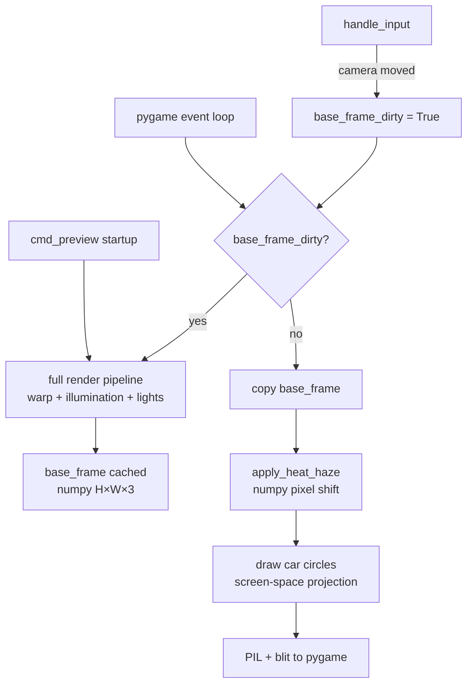
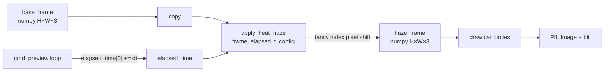
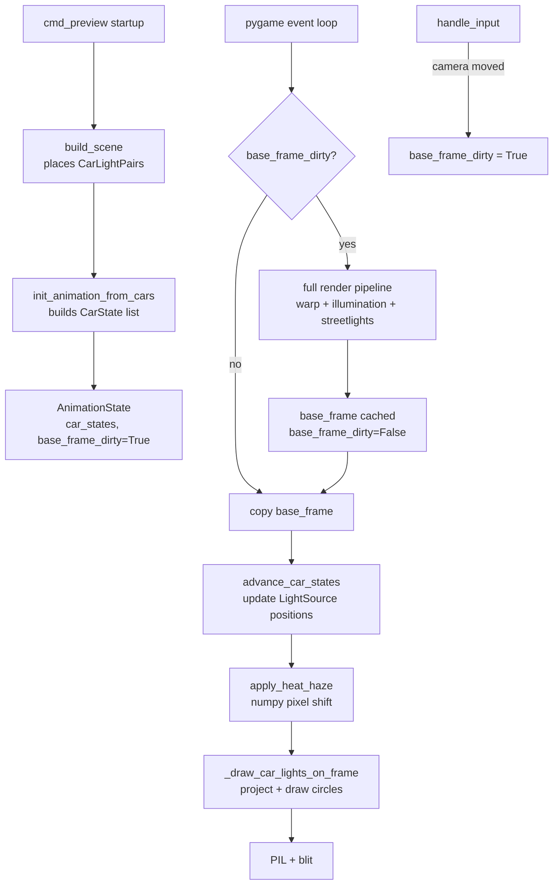

# Animation Design: Heat Haze and Moving Cars

**Project:** Streets at Night
**Date:** 2026-03-30
**Scope:** Two real-time animation features for the pygame preview path.

---

## Architecture Overview

The fundamental constraint driving this design: **the camera is stationary during animation**. Roads, buildings, and static streetlights do not move. Running the full warp pipeline (raycast + flat map sample + illumination) every frame is wasteful and unnecessary.

The correct architecture caches the fully composited scene as a `base_frame` and applies only cheap per-frame operations on top of it.

### Startup (once per camera position)

Run the full render pipeline once: warp raycast → flat map sample → illumination pass → static streetlight glow and cores. Cache the result as a `base_frame` (PIL Image converted to a `(H, W, 3)` numpy array for fast per-frame manipulation).

### Per-Frame Loop (cheap)

1. Copy `base_frame` into a working buffer
2. Apply heat haze: shift pixels in the working buffer using a sine wave displacement field (pure numpy fancy indexing — no raycast, no flat map lookup)
3. Draw car headlight and taillight circles on top of the shifted buffer (screen-space circle draws at projected 3D positions)
4. Convert to PIL and blit to the pygame surface

### Base Frame Invalidation

The `base_frame` must be regenerated when:
- The camera moves (any user input that changes camera position or orientation)
- Config changes that affect the illumination or flat map (not expected at runtime, but noted for completeness)

The simplest implementation: set a `base_frame_dirty = True` flag whenever `handle_input` reports a camera change, and regenerate at the top of the next frame before copying. This keeps the logic in `cmd_preview` and requires no structural changes to existing render functions.

### Preview Loop Data Flow



---

## Feature 1: Atmospheric Thermal Ripple / Heat Haze

### Approach: Post-Process Screen-Space Pixel Shift

**Decision:** Operate on the final composited output image, not inside the raycast.

The original design threaded `t_val` depth data out of `_raycast_to_flat_map` to drive distance-scaled distortion. That design is obsolete: `_raycast_to_flat_map` runs only at startup now, not per frame. The heat haze function receives only the post-composited numpy array and a time value.

**Why screen-space wins over UV distortion during raycast:** The raycast runs once and its outputs are baked into `base_frame`. There is nothing to hook into at frame time. A post-process screen-space pixel shift on the output image is the only viable approach.

**Distance proxy:** Without `t_val` available per frame, screen_y serves as a proxy for distance. In the aerial perspective camera, pixels higher on screen (lower screen_y values in image coordinates, toward the horizon) correspond to more distant ground. Pixels near the bottom of the frame are close. This is a valid and simple approximation — it requires no depth buffer and produces the correct perceptual result.

### Function Signature

```
apply_heat_haze(frame: np.ndarray, t: float, config: HeatHazeConfig) -> np.ndarray
```

`frame` is shape `(H, W, 3)`, dtype uint8. Returns a new array of the same shape. No mutation of the input.

This function lives in `rendering/warp_preview.py`. It has no dependency on the raycast, the flat map, or the scene — it is a pure image transform.

### Noise Function

**Decision:** Two-octave layered sine waves over screen coordinates and time.

Perlin or simplex noise requires a runtime Python implementation (slow at 1920×1080) or a dependency. Layered sine waves produce visually convincing heat shimmer and are trivially vectorized with numpy.

The displacement field:

```
dx(x, y, t) = A * scale(y) * (sin(f1*y + s1*t) + 0.5 * sin(f2*y + 0.7*x + s2*t))
dy(x, y, t) = A * scale(y) * 0.4 * (cos(f1*x + s1*t*0.8) + 0.5 * cos(f2*x + s2*t))
```

Where `f1`, `f2` are spatial frequencies (cycles per pixel), `s1`, `s2` are time speeds (radians/second), and `A` is max amplitude in pixels.

The x-component dominates so lights appear to sway laterally — the dominant visual character of heat shimmer near the horizon — with a smaller vertical component.

### Distance Proxy: screen_y Scaling

Pixels near the top of the image (horizon, distant ground) shimmer more. Pixels at the bottom (foreground, close ground) shimmer less. Scale is:

```
# Normalized screen_y: 0.0 at bottom of frame, 1.0 at top
norm_y = (H - 1 - screen_y) / (H - 1)
distance_scale = norm_y ** distance_exponent
```

`distance_exponent` of ~1.5 produces a natural roll-off. Sky pixels receive the same treatment (they are near the top), which is acceptable — there is no depth buffer to exclude them, and sky shimmer reads as heat rising.

The final displacement: `displacement_px = amplitude * distance_scale * noise_value`.

At `amplitude = 3.0`, mid-frame shimmer displaces ~1-2 pixels. Near-horizon features shimmer ~3-4 pixels. This reads as real thermal distortion at the camera altitude.

### Implementation: Pixel Shift via Fancy Indexing

```
# Conceptual — not code
screen_y_grid, screen_x_grid = meshgrid(arange(H), arange(W), indexing='ij')

dx = amplitude * scale(screen_y_grid) * (sin(f1*screen_y_grid + s1*t) + ...)
dy = amplitude * scale(screen_y_grid) * 0.4 * (cos(f1*screen_x_grid + ...) + ...)

src_y = clip(screen_y_grid + dy, 0, H-1).astype(int)
src_x = clip(screen_x_grid + dx, 0, W-1).astype(int)

output = frame[src_y, src_x]  # fancy indexing — pure numpy, no Python loops
```

The `screen_y_grid` / `screen_x_grid` meshgrids are precomputed once at startup and held in the animation state. The per-frame cost is the sine evaluations and the fancy index.

### Threading Time Through the Pipeline

The time value is injected from the `cmd_preview` loop:

```
elapsed_time[0] += dt
```

`elapsed_time` is a mutable single-element list captured in the closure (unchanged from the original design). The `_warp_pass` closure does not need to pass time to `render_warp_preview` anymore — heat haze is now applied after the frame is rendered, not inside it. The time value is read directly in the per-frame copy-and-haze step in `cmd_preview`.

### Files Modified

| File | Change |
|------|--------|
| `main.py` | Per-frame: copy `base_frame`, call `apply_heat_haze`, draw car circles, blit; track `elapsed_time`, `base_frame_dirty`; regenerate `base_frame` on dirty flag |
| `rendering/warp_preview.py` | Add `apply_heat_haze(frame, t, config)` as a standalone function; no changes to `render_warp_preview` signature |
| `config/schema.py` | Add `HeatHazeConfig` dataclass; add to `SceneConfig` |
| `config/defaults.py` | Add `[heat_haze]` section defaults |
| `config/loader.py` | Parse `[heat_haze]` section |
| `scene_config.toml` | Add `[heat_haze]` section |

`render_pipeline.py` is not modified for heat haze. `_raycast_to_flat_map` is not modified. `render_warp_preview` is not modified.

### Data Flow



### New Config Parameters

```toml
[heat_haze]
enabled = true
amplitude = 3.0          # max displacement in pixels at the horizon
freq1 = 0.003            # primary spatial frequency (cycles/pixel)
freq2 = 0.007            # secondary spatial frequency
speed1 = 0.4             # primary wave speed (radians/second)
speed2 = 0.6             # secondary wave speed
distance_exponent = 1.5  # falloff curve steepness (higher = more concentrated at horizon)
```

The `distance_scale_max` parameter from the original design is removed — it was tied to `t_val` depth which is no longer available. Distance scaling is now purely via `screen_y` normalization.

### Performance

At 1280×720 per frame:
- `sin`/`cos` over `(H, W)` arrays: ~2ms (numpy vectorized)
- Fancy indexing pixel shift: same order as a numpy array copy (~1ms)
- Meshgrid allocation: avoided by precomputing at startup

Total per-frame overhead for heat haze: **~3ms**. The raycast no longer runs per frame — it ran at ~10-15ms in the original design. The net result is a substantially cheaper animation loop.

---

## Feature 2: Moving Cars

### What Changes About the Static System

`place_cars` in `car_placer.py` is called once during scene construction. It places `CarLightPair` objects at fixed positions. For animation, each car gets a `CarState` tracking its parametric position along a segment, advanced each frame.

This design is unchanged from the original report.

### CarState Dataclass

```python
@dataclass
class CarState:
    segment_index: int        # index into scene.road_segments
    arc_distance: float       # meters along segment geometry, 0..segment_length
    speed: float              # meters per second
    travel_forward: bool      # True = segment geometry direction, False = reversed
    segment_length: float     # total length of current segment, meters
    pair_index: int           # index into scene.car_pairs for light update
```

`segment_length` is stored on `CarState` directly. The geometry is static; recomputing it every frame is pointless.

### AnimationState

```python
@dataclass
class AnimationState:
    car_states: List[CarState]
    elapsed_t: float
    screen_y_grid: np.ndarray   # (H, W) precomputed for heat haze
    screen_x_grid: np.ndarray   # (H, W) precomputed for heat haze
    base_frame: np.ndarray      # (H, W, 3) cached composited frame
    base_frame_dirty: bool
```

The meshgrids live here because they are static and tied to window resolution — precomputed once, reused every frame by `apply_heat_haze`. Putting them on `AnimationState` avoids reallocation and keeps `cmd_preview` clean.

`base_frame_dirty` starts `True`, triggering a full render on the first frame.

### Advancing Cars Each Frame

`advance_car_states(states, scene, dt)` updates all car states in-place. For each `CarState`:

1. Advance `arc_distance += speed * dt` (or `-=` if `travel_forward = False`)
2. If out of bounds: teleport to a random new segment (random `segment_index`, random `arc_distance`, random `travel_forward`, same speed)
3. Interpolate new center position and tangent via `_sample_at_distance`
4. Call `CarLightPair.update_position(center, tangent)` to mutate the light source positions

**Segment end behavior — teleport, not chaining.** Building a road topology graph from OSM data after ENU conversion is non-trivial. Teleport is invisible at camera altitude and requires zero graph infrastructure.

### Car Lights in the Animation Frame: Screen-Space Circles

This is the core departure from the original design. Car lights in animation are not rendered via `render_lights_preview` or any illumination pass. They are drawn directly as screen-space circles on the post-haze frame in `cmd_preview`.

For each `CarState`:
1. Project the car's `CarLightPair` light positions using the camera projection (the same projection the export path uses)
2. Check if the projected points are within screen bounds
3. Draw a small bright circle (headlights: warm white) and a red circle (taillights) at the projected screen coordinates

Drawing circles on a numpy array can be done with PIL `ImageDraw.ellipse` (convert to PIL briefly) or with a simple numpy distance mask. PIL is simpler and already a dependency.

This means:
- No `render_lights_preview` pass runs per frame
- No illumination map is rebuilt per frame
- The only per-car cost is one 3D→2D projection and two circle draws

The `LightSource` positions are still updated by `advance_car_states` (needed for the projection). The illumination map in `base_frame` reflects the static streetlights from startup and is not touched.

### Files Modified for Moving Cars

| File | Change |
|------|--------|
| `main.py` | Add `AnimationState`, `CarState` dataclasses; add `advance_car_states()`; add `init_animation_from_cars()`; add `_draw_car_lights_on_frame()`; update `cmd_preview` loop |
| `models/car.py` | Add `update_position(center, tangent)` method to `CarLightPair` |
| `config/schema.py` | Add `AnimationConfig` dataclass; add to `SceneConfig` |
| `config/defaults.py` | Add `[animation]` section defaults |
| `config/loader.py` | Parse `[animation]` section |
| `scene_config.toml` | Add `[animation]` section |
| `placement/car_placer.py` | No changes |

### Data Flow



### New Config Parameters

```toml
[animation]
enabled = true
car_speed_min = 8.0     # meters/second (~18 mph)
car_speed_max = 25.0    # meters/second (~56 mph)
```

---

## Trade-offs and Design Notes

### Heat Haze + Export

The export path (`cmd_render`) uses `PillowBackend` with per-segment projection, not the warp preview. `apply_heat_haze` is a pure image function and could be applied as a post-process to a still export render. This is out of scope for now but the function signature is compatible.

### Sky Pixels and Heat Haze

`apply_heat_haze` does not have a sky mask — sky pixels near the top of the frame will also shimmer. At camera altitude over San Bernardino at night, the sky is essentially black, so displaced sky pixels still produce black. No visible artifact is expected. If this becomes an issue, a horizontal band mask can be added to `HeatHazeConfig` (`sky_horizon_y: int`, pixels above which distortion is zeroed out).

### Spatial Index and Animated Lights

`scene.add_lights` inserts `LightSource` objects into the spatial index at initial positions. When cars move, the spatial index is not updated — doing so every frame (remove + reinsert) would negate the index's usefulness. `render_lights_preview` iterates `scene.lights` directly, not via the spatial index, so there is no correctness problem for the preview. The illumination pass (export only) also uses `scene.lights` directly. Car animation during preview does not use the spatial index at all — it uses direct circle draws.

### Static Car Illumination in base_frame

`base_frame` captures the scene at car positions from startup (wherever `place_cars` put them). As cars move, their illumination contribution in `base_frame` becomes stale. This is acceptable: the illumination contribution of individual car headlights to the ground at camera altitude is minimal. The visual effect of car motion comes from the animated circles, not from accurate per-frame illumination. If this becomes a visible artifact, `base_frame_dirty` can be set on every frame for cars — at the cost of running the full pipeline at 60fps, which defeats the architecture.

### Segment Index Stability

`CarState.segment_index` indexes into `scene.road_segments`. This list is built once and never mutated after scene construction. Indices are stable for the lifetime of the preview session.

---

## Summary of All New Config

```toml
[heat_haze]
enabled = true
amplitude = 3.0
freq1 = 0.003
freq2 = 0.007
speed1 = 0.4
speed2 = 0.6
distance_exponent = 1.5

[animation]
enabled = true
car_speed_min = 8.0
car_speed_max = 25.0
```

## Summary of File Changes

| File | Feature | Nature of Change |
|------|---------|-----------------|
| `main.py` | Both | `AnimationState`, `CarState`, `advance_car_states`, `init_animation_from_cars`, `_draw_car_lights_on_frame`; `cmd_preview` loop: base_frame caching, dirty flag, per-frame copy→haze→circles→blit |
| `rendering/warp_preview.py` | Heat Haze | Add standalone `apply_heat_haze(frame, t, config)`; no changes to `render_warp_preview` |
| `models/car.py` | Moving Cars | Add `update_position(center, tangent)` to `CarLightPair` |
| `config/schema.py` | Both | Add `HeatHazeConfig`, `AnimationConfig`; add both to `SceneConfig` |
| `config/defaults.py` | Both | Add defaults for both sections |
| `config/loader.py` | Both | Parse both new sections |
| `scene_config.toml` | Both | Add both new config sections |

`rendering/render_pipeline.py` is not modified. `_raycast_to_flat_map` is not modified. `render_warp_preview` signature is not modified. The export path is untouched.
